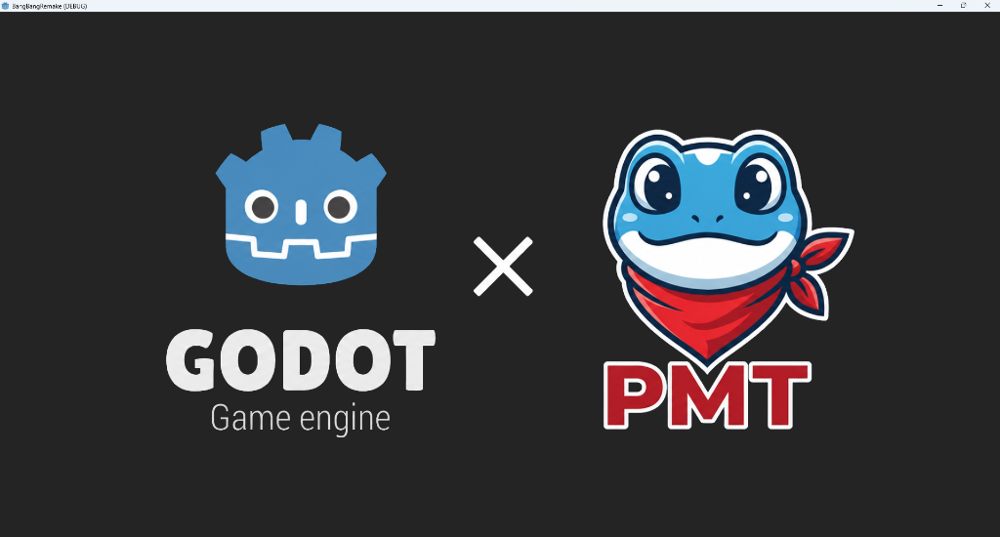
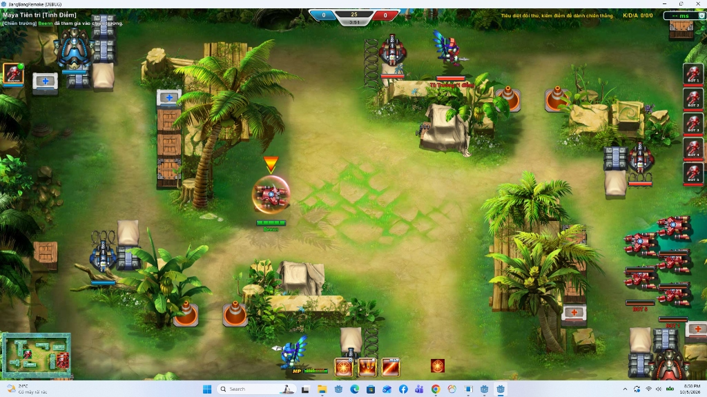
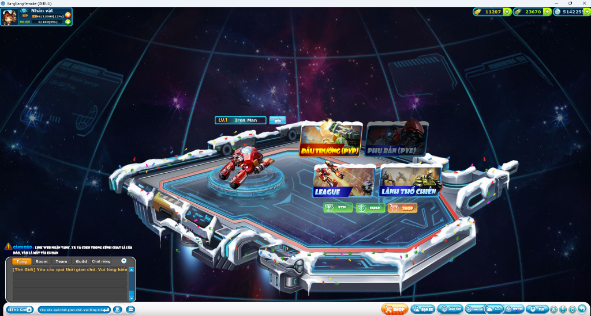
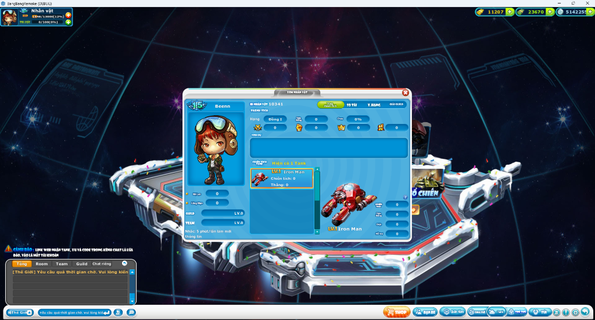
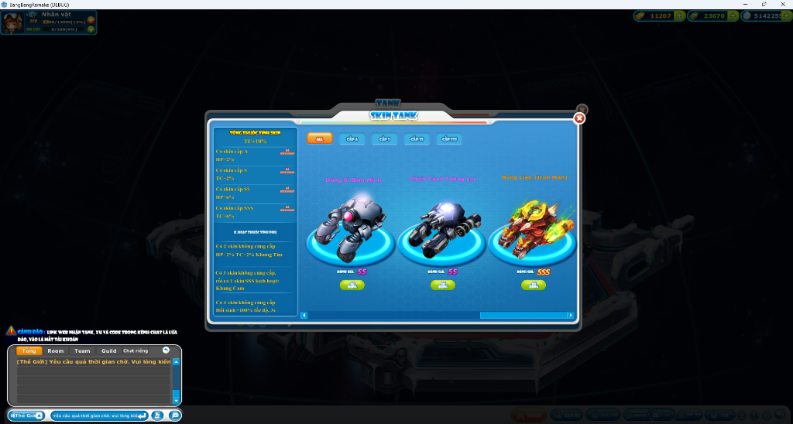

# 🚀 BangBang Remake - Fullstack 2D Top-Down Shooter & Server-Authoritative Architecture

<p align="center">
  
</p>

<p align="center">
  
  
  
  
  
</p>

Dự án tái hiện (Remake) game bắn xe tăng huyền thoại **BangBang**. 

Hệ thống được thiết kế theo mô hình **Server-Authoritative**, tách biệt hoàn toàn giữa Client đồ họa (Godot 4) và Backend xử lý logic/kinh tế/đồng bộ thời gian thực (Node.js + PostgreSQL + Redis).

---

## 🖼️ Hình Ảnh Thực Tế Dự Án (Screenshots)

### 1. ⚔️ Trận Đấu Realtime (Battlefield - Map Maya Tiên Tri)
Màn chơi chiến đấu Top-Down 2D hỗ trợ di chuyển, xoay nòng, bắn đạn, kỹ năng nhân vật (Iron Man Tank), thanh máu HP/Shield, Minimap, trụ phòng thủ (Turrets), quái/creeps và bảng điểm K/D/A.

<p align="center">
  
</p>

---

### 2. 🏰 Sảnh Chính (Main Lobby System)
Giao diện sảnh chính tái hiện nguyên bản với các chế độ **Đấu Trường (PVP)**, **Phụ Bản (PVE)**, **League**, **Lãnh Thổ Chiến**, khung Chat Thế Giới / Guild / Team, và hiển thị xe tăng đang chọn.

<p align="center">
  
</p>

---

### 3. 👤 Thông Tin Nhân Vật & Skin Tank (Character & Skin System)
* **Xem Thông Tin Nhân Vật**: Quản lý cấp độ, danh hiệu, tỷ lệ thắng, chỉ số và danh sách xe tăng đang sở hữu.
* **Bộ Sưu Tập Skin Tank**: Hệ thống trang phục xe tăng (Skin SS/SSS) tăng thuộc tính nhân vật (Dũng Sĩ Bình Minh, Chiến Cảnh Tương Lai, Hồng Liên Iron Man).

<p align="center">
  
  
</p>

---

## 📸 Tổng Quan Kiến Trúc Dự Án (Project Structure)

Dự án dạng **Monorepo** bao gồm 2 phần chính:

```text
remake_bang_bang/
├── 🎮 BangBangRemake/      # Game Client (Godot 4 Engine)
│   ├── assets/              # Tài nguyên đồ họa, âm thanh, UI, Shaders
│   ├── core/                # Autoload Singletons (GameSession, Network, Audio)
│   ├── scenes/              # Scene UI (Lobby, Auth, Shop) & Gameplay (Maya Map)
│   ├── scripts/             # GDScript (Component-based architecture)
│   └── docs/                # Cẩm nang kiến trúc & tài liệu kỹ thuật
│
├── 🖥️ BangBangServer/      # Backend & Realtime Game Server (Node.js)
│   ├── src/                 # REST API, WebSocket Manager, Match Workers, DB Migrations
│   ├── sql/                 # Schema & Database Migrations (PostgreSQL)
│   ├── test/                # Automated Smoke & Stress Tests
│   └── ops/                 # Operations, Runbooks & Security Telemetry
│
└── 📁 docs/images/          # Hình ảnh screenshot dự án phục vụ README & Portfolio
```

---

## 🔥 Điểm Sáng Kỹ Thuật (Technical Highlights)

### 1. 🎮 Game Client (Godot 4)
* **Component-Based Architecture**: Các đối tượng (Tank, Turret, Bullet) được xây dựng từ các Node thành phần decoupled (`HealthComponent`, `WeaponComponent`, `MovementComponent`), tương tác qua **Event/Signal Bus**.
* **SWF & Map Conversion Pipeline**: Tái cấu trúc animation khung hình Flash SWF và chuyển đổi map 2D Top-Down (Map Maya với 45 công trình/trụ, Tù trưởng và Footpoint).
* **VFX & Shader Customs**: Hiệu ứng UI và Gameplay nâng cao sử dụng Custom Shaders (`shine.gdshader`, global theme).

### 2. ⚡ Server-Authoritative PvP Engine (Node.js + WebSockets)
* **High-Performance In-Memory Simulation**: Trận đấu chạy vòng lặp fixed-step 50ms trong RAM. Server tự động tính toán AI, tầm đánh, va chạm, sát thương, cooldown kỹ năng và hồi sinh.
* **WebSocket v3 Realtime Protocol**: 
  * Truyền nhận state với **Delta Compression (`snapshot_delta`)** giảm đến 80% băng thông so me với Full Snapshot.
  * Tự động fallback linh hoạt giữa WebSocket và HTTP/REST khi mất kết nối.
* **Concurrency & Fencing**: Sử dụng DB Lease Fencing 5s + Checkpoint PostgreSQL 500ms, đảm bảo chống race condition khi chạy nhiều server worker node.

### 3. 💰 Server-Enforced Economy & Security
* **ACID Transactions & Idempotency**: Mọi giao dịch Shop, mua item, nhận thưởng trận đấu đều thực hiện dưới dạng PostgreSQL Transaction với **Idempotency Key**, chống duplicate purchase hay hack tiền từ Client.
* **Anti-Cheat & Rate Limiting**: Client chỉ gửi ý định (Intention/Command), Server validate toàn bộ. Hỗ trợ Device ID Fingerprinting (HMAC-SHA256) và IP Rate Limiting chống spam/botnet.

---

## 🛠️ Hướng Dẫn Khởi Chạy (Quick Start)

### Yêu cầu hệ thống:
* **Godot Engine 4.7** trở lên.
* **Node.js** (v20+), **PostgreSQL 18** và **Redis**.

---

### Step 1: Khởi động Backend Server

1. Di chuyển vào thư mục server:
   ```bash
   cd BangBangServer
   ```

2. Cài đặt dependencies:
   ```bash
   npm install
   ```

3. Khởi tạo Database (lần đầu tiên):
   ```bash
   npm run setup-db
   ```
   *(Nhập mật khẩu PostgreSQL local khi được hỏi)*

4. Chạy Server:
   ```bash
   npm start
   ```
   *Server sẽ chạy API tại `http://127.0.0.1:8080` và lắng nghe kết nối WebSocket.*

---

### Step 2: Khởi động Game Client (Godot 4)

1. Mở **Godot Engine 4.7**.
2. Chọn **Import** -> Trỏ đến thư mục `remake_bang_bang/BangBangRemake` và mở file `project.godot`.
3. Nhấn **F5** (Run Project) để chạy game. Main scene sẽ khởi chạy từ màn hình Đăng nhập / Sảnh chính (`res://scenes/auth/Login.tscn`).

---

## 🧪 Kiểm Thử (Testing & Quality Assurance)

Backend đi kèm hệ thống kiểm thử tự động phong phú:

```bash
cd BangBangServer

# Smoke test kiểm tra kết nối PostgreSQL & Economy
npm run test:economy-db

# Test logic trận đấu PvP In-Memory
npm run test:battle-memory-db

# Run toàn bộ suite test
npm test
```

---

## 📜 Giấy Phép & Tuyên Bố (Disclaimer)

* Dự án được phát triển hoàn toàn vì mục đích **Học tập, Nghiên cứu kỹ thuật & Xây dựng Portfolio (Educational & Non-commercial)**.
* Toàn bộ nhãn hiệu và tài nguyên gốc thuộc về chủ sở hữu bản quyền tương ứng.
